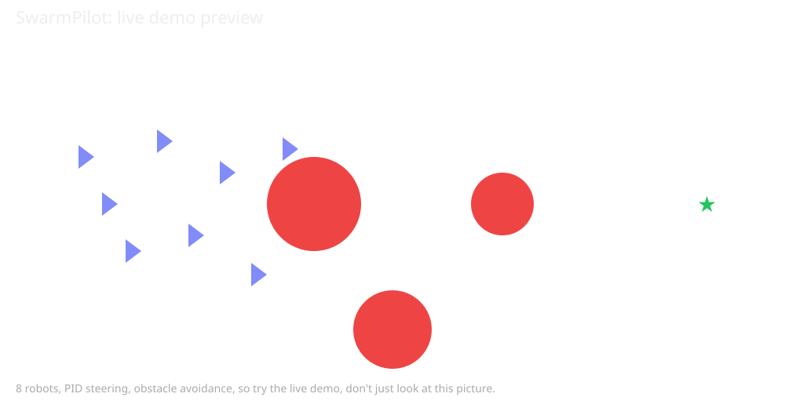

# 🤖 SwarmPilot.    Self-Tuning Robot Swarm Simulator

**Live demo:** https://blip-geta22.github.io/swarm-pilot/

A swarm of autonomous robots that navigates around obstacles to a target,
steered by PID control, kept apart by flocking rules, and tuned by a genetic
algorithm that learns its own PID gains.



No hardware needed. The whole thing runs in Python, and there is a live
browser demo too.

## Results

Measured with the Python simulator, 8 robots, same seed and target:

| Gains | Reached | Steps | Collisions | Score |
|---|---|---|---|---|
| Default (Kp=2.0, Ki=0.05, Kd=0.30) | 8/8 | 195 | 3 | 92.5 |
| Evolved (Kp=0.18, Ki=0.217, Kd=0.45) | 8/8 | 191 | 0 | 33.5 |

The evolved gains cut the tuning score by 64% and collisions from 3 to 0.
Score = total distance left + collisions × 20 + steps × 0.1, so it trades
off distance, collisions, and time — it does not just reward speed.

Web demo, tested headlessly with `node web/test_sim.js` (same physics as
the browser):

| Kp | Reached | Steps | Collisions |
|---|---|---|---|
| 0.5 | 8/8 | ~274 | 0 |
| 2.0 | 8/8 | ~196 | 0 |
| 5.0 | 8/8 | ~200 | 0 |

Steps vary slightly run to run because the web demo adds sensor noise.

Kp 0.5 is sluggish, Kp 2.0 is the sweet spot, Kp 5.0 overshoots and turns
more — the sliders change behaviour, they are not just labels.

## Watch it live

Open `web/index.html` in any browser, or use the live demo link above.
Drag the Kp / Ki / Kd sliders and watch the swarm react in real time.

The browser version is a simplified visualization of the same PID and
avoidance logic in `swarm_pilot/`. It uses turn-rate PID with integral
clamping, sensor noise, and clear-side obstacle avoidance, and it is
tested headlessly — it does not model full differential-drive wheel speeds.

## Run it

```bash
# 8 robots navigate to the target
python -m swarm_pilot.cli run --robots 8

# Evolve better PID gains automatically
python -m swarm_pilot.cli tune --generations 8
```

## How it works

- **Robot:** forward speed + turn rate (a differential-drive approximation,
  with no lateral movement), virtual lidar, sensor noise
- **Control:** PID on heading error, with anti-windup and speed control
  (slow near obstacles, slow near the target)
- **Swarm:** separation flocking so robots don't clump or collide
- **Auto-tuner:** genetic algorithm — keep the best half of the population,
  average pairs of gains to cross-breed them, add Gaussian mutation, repeat.
  Score = distance left + collisions × 20 + time.

### Why the integral is clamped

If a robot is stuck against an obstacle, heading error stays high and the
integral term would pile up. Without a clamp, once it gets free it would
spin wildly from all that stored integral. The clamp is anti-windup: it
caps the integral so the controller recovers cleanly.

## Requirements

The core pipeline uses only the Python standard library. `pytest` is
optional, for the tests. No other packages are required.

## Layout

```
swarm_pilot/
  pid.py          # PID controller
  robot.py        # robot + lidar + flocking
  simulation.py   # swarm, obstacles, scoring
  tuner.py        # genetic PID auto-tuner
  cli.py          # run / tune commands
web/index.html    # live browser demo
web/sim.js        # browser physics, tested headlessly
docs/             # GitHub Pages copy of the browser demo
tests/            # pytest tests
```

## Tests

```bash
python -m pytest
node web/test_sim.js
```

Both pass as of the latest commit. Python tests: 3 passed. Web tests:
Kp 0.5, 2.0, and 5.0 all reach 8/8 with 0 collisions.

## License

MIT — see `LICENSE`.
